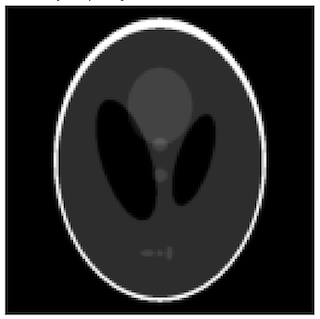
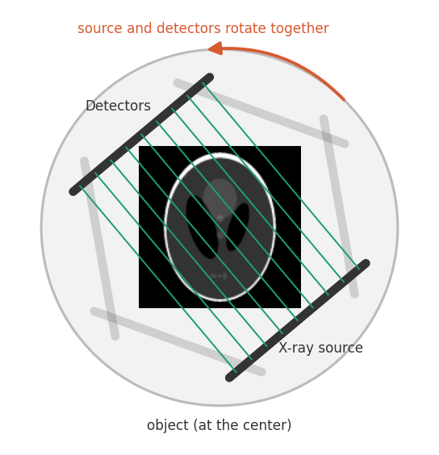
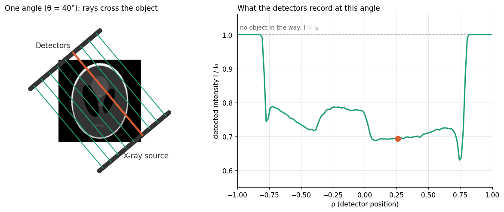
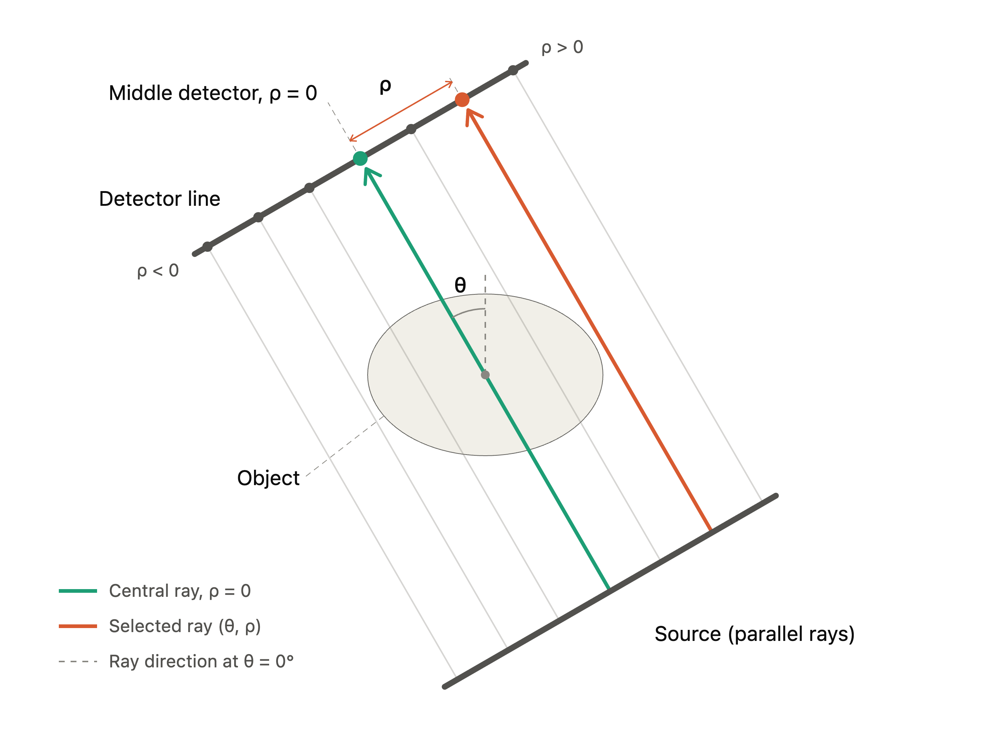
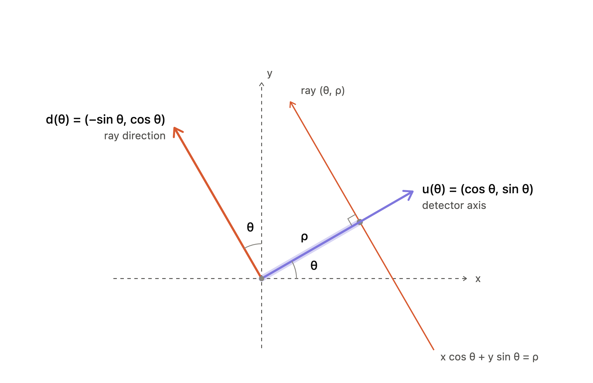
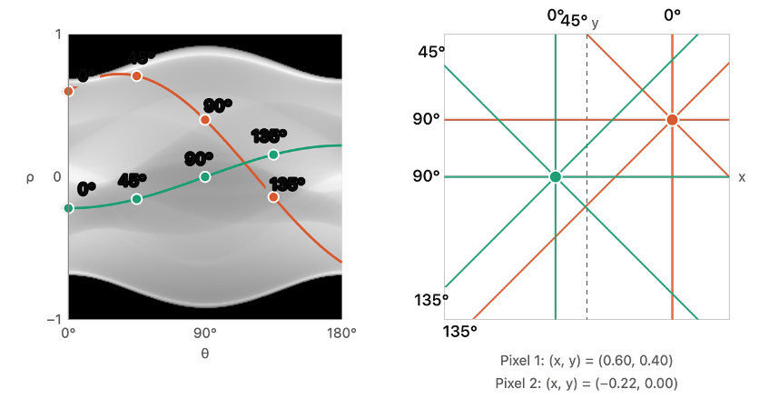
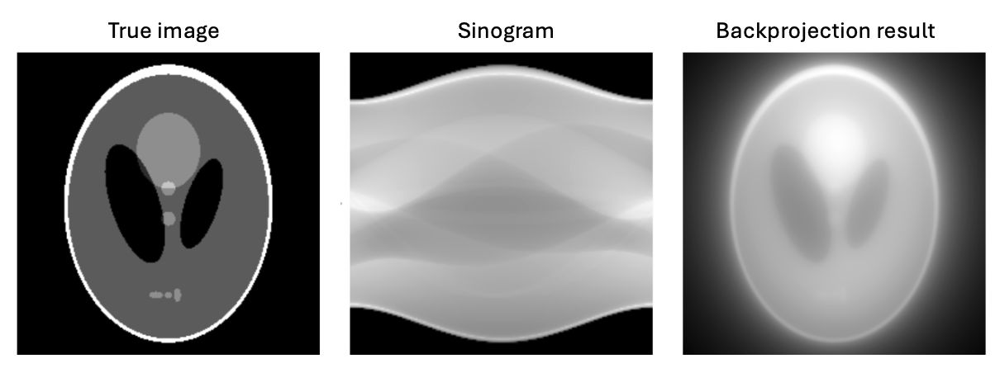
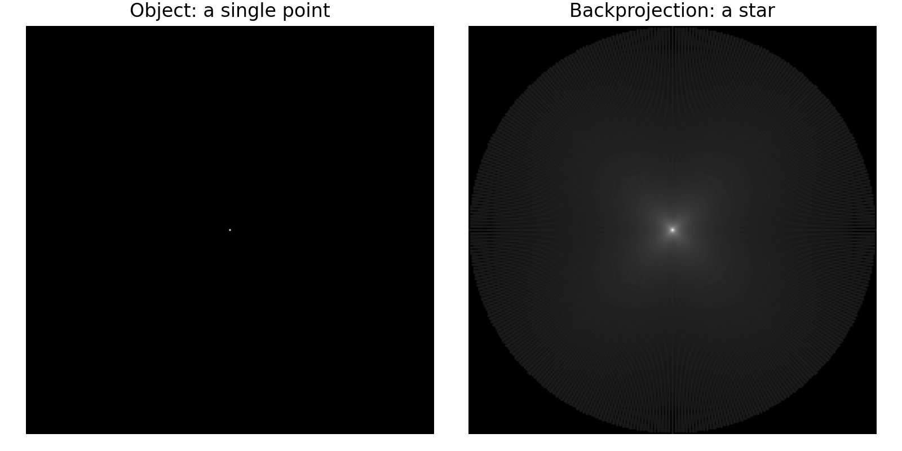

# CT, the Radon transform and backprojection

During my postdoc, I worked with Prof. Andreas Velten and his [Computational Optics](https://www.compoptics.wisc.edu) group at the University of Wisconsin-Madison. At the time, Andreas was working on a project called Revolutionary Enhancement of Visibility by Exploiting Active Light-fields ([REVEAL](http://darpa.mil/news/2015/untapped-information-photons)), funded by DARPA. The idea was based on research that Andreas and his former advisor at MIT, Dr. Ramesh Raskar, were working on, see [this 2012 Nature Communications paper](https://www.nature.com/articles/ncomms1747). 

Using ultra-fast lasers and sensitive cameras, the goal was to reconstruct a hidden image by illuminating a wall (with a collimated light source, a laser) so that the photons would bounce off and scatter everywhere, hitting the objects in the hidden scene. Some of these photons would then travel back to the wall and they would be captured by a very sensitive camera called single-photon avalanche diode (SPAD). The hidden scene can be reconstructed using the **backprojection** algorithm. I contributed to different aspects of this project, most notably a [2019 Nature publication](https://www.nature.com/articles/s41586-019-1461-3).

In that research area, I knew how backprojection worked. However, I also knew that the algorithm was "borrowed" from computed tomography (CT). In this repository, I am explaining how the forward model and backward reconstruction (more on these terms below) work in this context. 

> [!IMPORTANT]
> This is a *simplified* discussion based on my understanding of the mathematics of how the Radon transfrom and backprojection work. I am not claiming that what follows explain exactly how a current CT device works. 

> [!NOTE]
AI tools were used as coding assistants to refine the implementation of the code and improve the readability of this file.

## 1. What you will learn

- How a CT scanner acquires the data, called sinogram
- How backprojection turns a sinogram back into an image, and why the result is blurry and how a filtered backprojection helps

## 2. Theory and assumptions

The following section draws on the documentation for Python's `scikit-image` implementation of the [Radon Transform](https://scikit-image.org/docs/stable/auto_examples/transform/plot_radon_transform.html) as well as the information found on [Wikipedia](https://en.wikipedia.org/wiki/Radon_transform#Relationship_with_the_Fourier_transform).

### 2.1 Introduction

#### 2.1.1 The phantom

How do we know if the data acquisition and the imaging algorithm work? In radar, you would test them assuming a point-like target with known radar-cross section (RCS) and distance. 

Since we are imaging, the equivalent here is to use a known object that you want to image and that you fully know its properties. Thus, we will use the Shepp-Logan phantom, representing a simplified model of the human head, available from Python's `scikit-image` module. The image is in grayscale and, specifically, the brightness is the **attenuation coefficient** $\mu$, how strongly each point absorbs X-rays (more on this later on).




#### 2.1.2 Forward and backward models in imaging

When we talk about imaging and regardless of the application, we work with two models, specifically

- A **forward model** which explains how the data is acquired, and 
- A **backward (inverse) model**, which explains how to reconstruct the object of interest given the data.

Mathematically, the forward model is defined as 

$$
\mathbf{b} = \mathcal{F}\{\mathbf{a}\},
$$

where $\mathbf{a}$ is what we want to image, $\mathbf{b}$ is what we measure and $\mathcal{F}\{\cdot\}$ is the forward model. For example, in the radar domain, a forward model assumes that, if a target is at a given range, the EM wave will be a scaled and delayed version of the transmit wave. Typically, we assume that the model is linear. Thus, the operation can be written in matrix form 

$$ 
\mathbf{b} = \mathbf{F}\mathbf{a}.
$$ 

The backward model answers the following question: "given $\mathbf{b}$, how do we get $\mathbf{a}$"?

#### 2.1.3 How a CT scanner acquires the data

In this repo, we are assuming that a CT scanner has an X-ray source and a row of detectors on opposite sides of the object being imaged, see the black lines in the image below. The source and detectors rotate together.



X-rays travel through the body rather than being reflected back toward the source. As they propagate through different materials, some of their energy is absorbed or scattered, reducing the intensity that reaches the detector. Each ray starts with an initial intensity \(I_0\). As it travels through the body, its intensity decreases continuously. The rate of this decrease depends on the material's attenuation coefficient, \(\mu\), and the distance traveled through that material. Accumulating these contributions along the entire path \(L\) gives the **Beer-Lambert law**:

$$
I = I_0 \exp \left( -\int_L \mu ~ dl \right).
$$

Here, the integral represents the total attenuation accumulated along the ray's path. A ray that does not go through the object has no attenuation, so $I=I_0$.

As always, a picture is worth a thousand words, so let us take a look at one. The left panel below shows the acquisition at a specific angle. In the right panel, we are showing what each detector is capturing. The x-axis represents the detector's position (normalized wrt the length of the line on which they are located), the y-axis represents the (normalized wrt $I_0$) intensity that was captured. As mentioned above, when $I=1$, the ray did not pass through the object. If $I<1$, it did.



CT reconstruction typically works with a logarithmic transformation of the measured intensity

$$
-\ln\left(\frac{I}{I_0}\right) = \int_L \mu ~ dl ~~~~(\dagger)
$$ 

Why do we do this? Because the logarithm transforms the exponential attenuation relationship into an additive one.

**Implied assumptions**
- **Parallel rays.** Real scanners often use fan or cone beams.
- **A single X-ray energy.** Real beams contain many energies, and $\mu$ depends on the energy.
- **Straight rays that are only attenuated.** Scattered radiation that still reaches a detector is ignored.
- **No noise**, and perfect detectors.

### 2.2 The forward model

#### 2.2.1 The Radon-transform

Consider the figure below, where we are defining two important ray parameters.



The first parameter is the angle at which the scanner is acquiring, **$\theta$**. When $\theta = 0^{\circ}$ the source and detectors are parallel wrt to $x$. Changing $\theta$ rotates the whole scanner. The second parameter is the detector position, **$\rho$**, along its line. When $\rho = 0$, it refers to the middle detector. Positive and negative values are the two sides.

How do $\theta$ and $\rho$ map to Cartesian coordinates? Take a look at the figure below, in which the source, detectors and object are omitted, so that we can focus on the geometry. Rotating the scanner by $\theta$ (counter-clockwise) rotates the detector axis $\mathbf{u}(\theta) = (\cos\theta, \sin\theta)$ and the ray direction $\mathbf{d}(\theta) = (-\sin\theta, \cos\theta)$ along with it. The two stay perpendicular. The ray $(\theta, \rho)$ is the line parallel to $\mathbf{d}(\theta)$ that crosses the detector axis at distance $\rho$ from the origin, namely

$$
x\cos\theta + y\sin\theta = \rho .
$$



Recall $(\dagger)$. We can now express it using $(\theta, \rho)$, namely

$$
p(\theta, \rho) = -\ln \left( \frac{I(\theta,\rho)}{I_0} \right) = \int_{L(\theta,\rho)} \mu ~ dl,
$$

where $I(\theta,\rho)$ is the intensity recorded by the detector at position $\rho$ when the scanner is at angle $\theta$, and $L(\theta,\rho)$ is the ray defined above.

The line $L(\theta,\rho)$ can described with $\mathbf{u}(\theta)$ and $\mathbf{d}(\theta)$ by

$$
L(\theta,\rho) = \{\, \rho\,\mathbf{u}(\theta) + t\,\mathbf{d}(\theta) : t \in \mathbb{R} \,\}.
$$

Here $t$ is the position along the ray. Since $\mathbf{d}(\theta)$ has length one, a step $dt$ along the parameter is a step of length $dl = dt$ along the ray. The line integral therefore becomes an ordinary integral over $t$

$$
p(\theta,\rho) = \int_{L(\theta,\rho)} \mu \, dl = \int_{-\infty}^{\infty} \mu\big(\rho\,\mathbf{u}(\theta) + t\,\mathbf{d}(\theta)\big)\, dt .
$$

Writing out the coordinates of the point on the ray, we get

$$
p(\theta,\rho) = \int_{-\infty}^{\infty} \mu\big(\rho\cos\theta - t\sin\theta,\; \rho\sin\theta + t\cos\theta\big)\, dt .
$$

The integral above is exactly what a CT detector measures, and it makes the picture from the previous section precise. In that figure, reported again below, we fix $\theta = 40^{\circ}$ and follow a single ray $(\theta, \rho)$, shown in orange. The left panel show the acquisition angle and higlights one particular ray arriving at a particular detector. The right panel shows the value captured by all the detectors. The orange dot represents the value arriving at the detector of interest, which was computed using the integral above.


Finally, note that the integral above is the *forward* model. In the previous section, we had defined it as $ \mathbf{b} = \mathbf{F} \cdot \mathbf{a}$. In the CT case, $\mathbf{b} \rightarrow p(\theta, \rho)$, $\mathbf{F}$ is the integral, and $ \mathbf{a} \rightarrow \mu(x,y) $.

#### 2.2.2 The sinogram

For a fixed angle $\theta$, measuring all detector positions $\rho$ gives one *projection* $p(\theta,\cdot)$. Repeating this for every angle and stacking the projections gives a 2D image with $\theta$ on one axis and $\rho$ on the other. This image is called the *sinogram*, and it is the Radon transform of $\mu$. It gets its name from the fact that a single point at $(x_0, y_0)$ appears in it as a sine wave, $\rho = x_0\cos\theta + y_0\sin\theta$.

### 2.3 The inverse model using backprojection

Assume that we just used the CT device to get the sinogram of the phantom. How do we get the phantom image back? Each measurement $p(\theta,\rho)$ is the total attenuation along one ray. It tells us *how much* material the ray crossed, but not *where* along the ray it sits. To address this, we use **backprojection**. At a high level, it asks the following question for every pixel $(x,y)$: *if there were an object here, which measurements would it have influenced?* For each angle $\theta$, there is a single ray that passes through the pixel, i.e. the ray with $\rho = x\cos\theta + y\sin\theta$. So we let the pixel collect the readings of those rays and add them up:

$$
\hat{\mu}_\text{bp}(x, y) = \int_0^{\pi} p(\theta,\; x\cos\theta + y\sin\theta) \, d\theta,
$$

where the $\hat{(\cdot)}$ operator indicates the reconstructed image (or in the CT case, attenuation map). The figure below visualizes this integral for two pixels (cf. the green and orange dots in the right panel). The result is a star centered on the pixel.



Now consider the image below, which shows the true object (left), the acquired data, i.e. the sinogram (center), and the image reconstructed by backprojection (right). The reconstruction is blurry, borders in particular (*if you have some image processing background, you might know where I am going with this*).



To explain why, let's consider a point-like object, not the phantom, as shown in the left panel below. When performing backprojection, the result is a star not a point, whose intensity decays approximately with $1/r$ with distance from the point. Because any image is a sum of points, backprojection blurs the whole image with this $1/r$ kernel.



The blur is easiest to describe in terms of *spatial frequencies* (defining an object's image as $f(x,y)$, its spatial frequencies are defined in the 2D spatial frequency domain, ie $F(X,Y) = \text{FT}_2 \{ f(x,y) \}$). Broad, smooth regions of an image change slowly and are made of *low* spatial frequencies, whereas sharp edges and fine details change abruptly and are made of *high* spatial frequencies. A blur turns down the high frequencies relative to the low ones. To counter this effect, we need to boost the high frequencies again, in proportion to how high they are. A filter whose gain grows linearly with frequency is called a **ramp filter**. It can be shown that the ramp filter undoes the $1/r$ blur exactly, and can directly be applied to the sinogram, before applying backprojection. Defining $\tilde{p}(\theta, \rho)$ as the filtered sinogram, we obtain the reconstructed image as

$$
\hat{\mu}_\text{fbp}(x, y) = \int_0^{\pi} \tilde{p}(\theta,\; x\cos\theta + y\sin\theta) ~ d\theta,
$$

which is the **filtered backprojection** (FBP) operation.

## 3. How to run the code

Both scripts need the following Python modules:

- `numpy`: arrays and the math.
- `scipy`: `scipy.ndimage.map_coordinates` samples the image along each ray.
- `scikit-image`: provides the Shepp-Logan phantom (it ships with the package, so nothing is downloaded) and resizes it.
- `matplotlib`: the figures, sliders and buttons.

```
pip install numpy scipy scikit-image matplotlib
```

### 3.1 `forward.py`: building the sinogram

```
python forward.py
```

This script applies the forward model to the phantom, i.e. it computes the Radon transform, and shows how the sinogram is built. Note that the script computes the line integral $p$ directly: it skips the intensity $I$ (and the step $-\ln(I/I_0)$ of Section 2.1.3), so the second panel shows $p$ rather than the normalized intensity of the figures above. A window opens with three panels: the object with the rays, the projection at the current angle, and the sinogram. The two sliders tell you where you are in the sinogram:

- **Angle θ (°)** selects the acquisition angle, from 0° to 179°. It picks the column of the sinogram that is currently being measured.
- **Detector index** selects one of the 128 detectors, i.e. one ray of that angle. It picks the point within that column, and the value of that point is the ray sum printed in the first panel.

The **Exit** button closes the window.

### 3.2 `inverse.py`: reconstructing the image

```
python inverse.py
```

This script goes the other way, from the sinogram back to the image. It imports the phantom and the Radon transform from `forward.py`, so keep both files in the same folder. A window opens with four panels: the true object, the sinogram, the image reconstructed by backprojection, and the image reconstructed by filtered backprojection. The slider **Angles used K** sets how many projections are used (1 to 180), so you can watch the reconstructions build up as more angles are added. The **Exit** button closes the window.

The image size and the number of detectors and angles are set by the constants `N` and `N_ANGLES` at the top of `forward.py`.

## 4. Code walkthrough

### 4.1 `forward.py`

- **`phantom()`**: loads the Shepp-Logan phantom from `scikit-image` and resizes it to an `N` x `N` image.
- **`radon(mu)`**: computes the sinogram of the image `mu`. For every angle and every detector, it samples the image along the ray and adds up the samples, which approximates the line integral of Section 2.2.1. The result is a matrix with one row per angle and one column per detector. It is written by hand (no library Radon transform), so you can read the definition straight off the code.
- **`main()`**: builds the three panels and the two sliders. The sinogram is computed once at start-up, and moving a slider only updates what is highlighted: the selected ray, the marker on the projection and the marker on the sinogram.

### 4.2 `inverse.py`

It reuses `phantom()` and `radon()` from `forward.py` to get the sinogram, and then adds the following.

- **`ramp_filter(sino)`**: applies the ramp filter to every projection (every row of the sinogram). Each row is taken to the frequency domain, boosted in proportion to the frequency, and brought back, which undoes the blur of Section 2.3.
- **`backproject(sino)`**: for every angle, it smears the projection back across the image, so that each pixel picks up the reading of the ray that passes through it. Each smeared projection is multiplied by $d\theta = \pi/\text{N\_ANGLES}$, the angular step, because the sum over angles approximates the integral $\int_0^\pi \dots d\theta$ of Section 2.3. The results are accumulated into a running sum over the angles, so that the slider can show any K without recomputing.
- **`main()`**: computes both reconstructions once at start-up, one from the plain sinogram (backprojection) and one from the filtered sinogram (filtered backprojection). It builds the four panels and the slider, and moving the slider only selects which precomputed image to display.

## 5. Disclaimer

This project is for educational purposes only. It is a deliberately simplified model of the CT scanner. It assumes parallel rays, noise-free data, a monochromatic beam and a plain ramp filter in the reconstruction. This simulation should not be used for the design, validation or safety assessment of a real CT imaging system.
